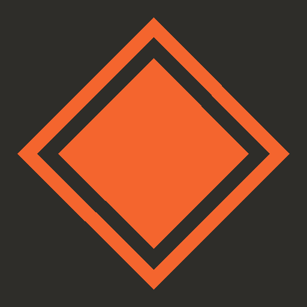
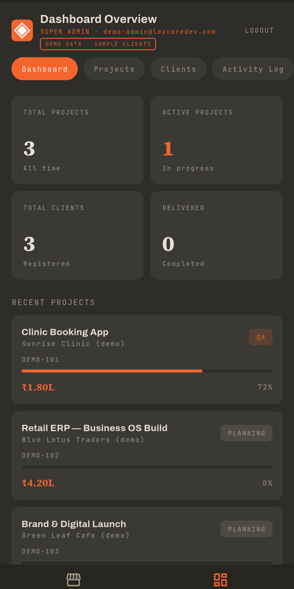
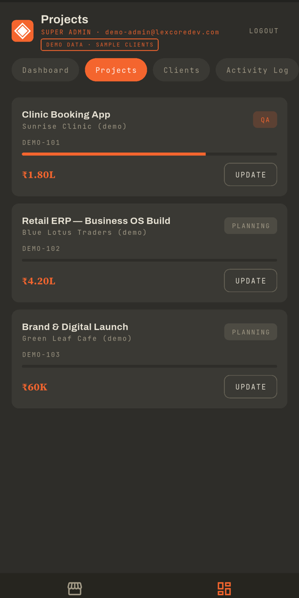
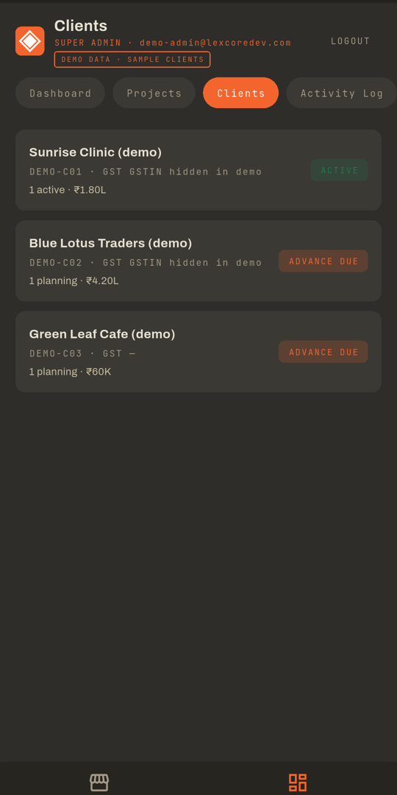
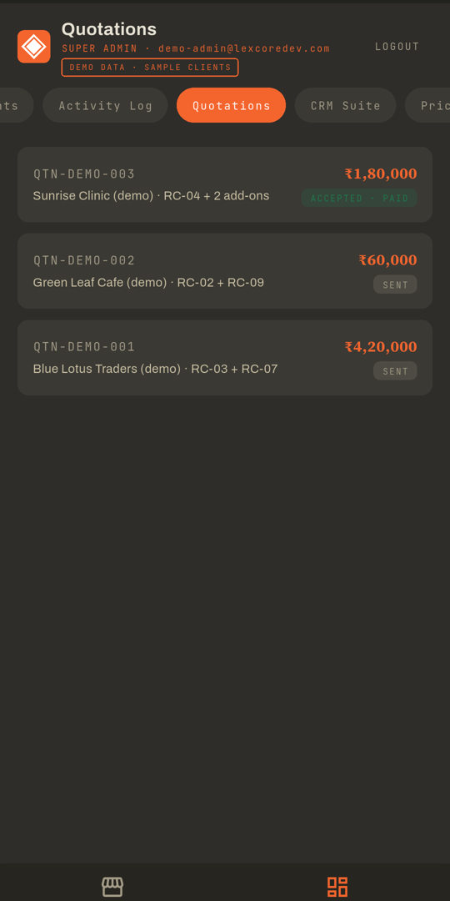

# Lexcore Dev — Client Portal + CRM

A two-sided Flutter app: **clients** track their custom software project, and the **studio team** runs projects, clients and quotations from a built-in CRM.

[**Get it on Google Play**](https://play.google.com/store/apps/details?id=com.lexcore.lexcore_dev_app) · [Start a project with us](https://lexcoredev.com/book.html)

> **Showcase repository.** This repo presents a live product we built. The application source code is private. Screenshots below use **demo data with fictional sample clients**.

## CRM screens (demo data)

| Dashboard | Projects | Clients | Quotations |
|---|---|---|---|
|  |  |  |  |

## Features
- **Dashboard:** total and active projects, clients, deliveries, and recent projects with progress.
- **Projects:** milestone progress, status (planning, QA, delivered) and quick updates.
- **Clients:** client records with project count and payment status.
- **Quotations:** numbered quotes with status (sent, accepted).
- **Role-based access:** super admin, read-only viewer, and client (sees only their own project).
- **Client side:** service catalogue, booking and project tracking.

## Built with
Flutter · Dart · REST API · role-based auth

---
Built by <a href="https://github.com/Cortina-Lab">Cortina Lab</a>, a <a href="https://lexcoredev.com/">Lexcore Dev</a> studio · © 2026 Lexcore Enterprises Pvt. Ltd. · <a href="https://lexcoredev.com/cortinalab.html">Hire us</a>
